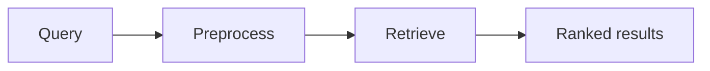

# RAG Chapter Documentation

Use this skill to turn user-supplied course material into accurate, maintainable documentation for the repository's RAG Search System learning project.

## Scope

This is a documentation workflow. Do not change application code unless the user explicitly asks for an implementation change or the documentation task requires a small code correction to make a documented command truthful. Prefer documenting a mismatch as a limitation over silently refactoring working code.

The repository documentation lives under `docs/`, with one numbered Markdown file per course chapter:

- `01-preprocessing.md`
- `02-tf-idf.md`
- `03-keyword-search.md`
- `04-semantic-search.md`
- `05-chunking.md`
- `06-hybrid-search.md`
- `07-llms.md`
- `08-reranking.md`
- `09-evaluation.md`
- `10-augmented-generation.md`
- `11-agentic.md`
- `12-multimodal.md`

The chapter number and filename must match the roadmap in `docs/README.md`.

## Inputs

Expect the user to provide one or more sections copied or summarized from the course. Treat that material as source material, not as the only authority. Preserve the course's learning order and assignment intent, but rewrite in original concise prose and add independent engineering context.

Before drafting, identify:

1. The chapter number and title.
2. The supplied section order.
3. Concepts, formulas, assignments, commands, and expected behavior.
4. Which claims describe this repository versus the course's reference project.
5. Existing repository modules, commands, cache files, tests, and current documentation that support or contradict the material.

If the chapter number or target file is ambiguous, ask one concise clarification before editing.

## Workflow

### 1. Inspect the local implementation

Read the current target chapter, `docs/README.md`, and the nearest implementation surface. For RAG search chapters, inspect relevant files under `cli/`, `data/`, `cache/`, and `pyproject.toml` as needed.

Use the code as the source of truth for statements beginning with phrases such as "this project", "the current CLI", or "the implementation". Check:

- Actual function and class names.
- CLI subcommands and argument order.
- Input and output paths.
- Cache artifacts and rebuild requirements.
- Preprocessing applied to both documents and queries.
- Score formulas, default constants, and rounding behavior.
- Known limitations and unimplemented future stages.

Do not infer that a course assignment is implemented merely because the chapter material describes it.

### 2. Choose the smallest documentation edit

If the target file is a placeholder, replace it with a complete chapter. If it already contains approved material, preserve it and add only the new or corrected sections. Update the roadmap status in `docs/README.md` when the user says the chapter is complete or approves the draft.

Use the existing chapter style:

```markdown
# Chapter N: Title

> Status: Complete draft based on the supplied course material
>
> Course scope: ...
```

A finished chapter should normally contain:

- An opening explanation and learning context.
- The supplied sections in their original order.
- Key terminology and formulas.
- A repository implementation walkthrough.
- At least one data-flow or process diagram.
- Runnable repository commands and small code snippets where useful.
- Dos and don'ts.
- Failure modes and edge cases.
- Verification steps.
- References and further reading.
- A link back to `README.md`.

### 3. Separate three levels of truth

Label or clearly distinguish:

- **Course concept:** what the lesson teaches.
- **Repository behavior:** what the current files actually do.
- **Production context:** standard alternatives, trade-offs, and later improvements.

Do not present a teaching shortcut as a universal best practice. Call out assumptions such as lexical versus semantic retrieval, raw versus normalized TF, smoothing, field mixing, cache trust, relative paths, and score rounding when they affect behavior.

### 4. Write safe Mermaid diagrams

Use Mermaid for useful data flow, sequence, ranking, or component diagrams. Keep node labels simple and avoid parser-sensitive punctuation.

Prefer:



Avoid comma-separated quoted node labels such as `D["one", "two"]`; use slash-separated or `<br/>` text instead. Do not put raw tabs or control characters in diagrams.

### 5. Write safe KaTeX formulas

Use fenced display math with literal backslashes:

```markdown
$$
\operatorname{score}(d,q) = \sum_{t \in q} \operatorname{score}(t,d)
$$
```

Never generate Markdown formulas through a normal Python string containing sequences such as `\f`, `\t`, or `\r`; those become form feed, tab, and carriage-return control characters. If a Python-based file-writing fallback is unavoidable, use raw strings or escape every backslash and scan the result for control characters.

### 6. Validate before finishing

Run the narrowest available checks after editing:

- `git diff --check`.
- Confirm all Mermaid fences are balanced and contain no control characters.
- Confirm formulas contain literal commands such as `\\frac`, `\\times`, `\\left`, and `\\right` where intended.
- Verify every local Markdown link points to an existing workspace file.
- Check that the target chapter has the supplied section headings in order.
- Run documented CLI examples when they are safe and available.
- Compile or run affected Python only if code was changed or the documentation depends on an executable command.

If a Mermaid renderer is available, render the diagrams. Otherwise, perform structural checks and report that rendering was not available.

## Repository-specific guidance

The first three completed chapters establish these facts:

- Chapter 1 documents case folding, ASCII punctuation removal, whitespace tokenization, stopword filtering, and Porter stemming.
- Chapter 2 documents the inverted index, raw TF, smoothed TF-IDF, persisted cache files, and score limitations.
- Chapter 3 documents BM25 IDF, `k1 = 1.5`, `b = 0.75`, document-length normalization, ranked `bm25search`, and the current per-term rounding behavior.

For later chapters, link back to the relevant earlier chapter rather than duplicating its full explanation. Keep the distinction between the basic unranked `search` command, BM25 keyword retrieval, and future semantic or hybrid retrieval explicit.

## Copyright and references

Summarize supplied course material in original wording. Do not reproduce large copied passages, images, or proprietary lesson text. Link to stable public references such as official Python or library documentation, academic papers, and canonical definitions. Course-specific commands or IDs may change; prefer repository commands and describe course submission commands generically unless the user explicitly requests a lesson ID.

## Completion report

Finish with a concise report containing:

1. The chapter file updated.
2. Any roadmap or cross-chapter files updated.
3. Validation performed and its result.
4. Any unresolved ambiguity or implementation mismatch.
5. Whether changes were committed; never commit unless the user explicitly asks.
