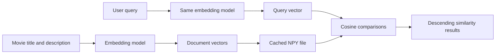

# Chapter 4: Semantic Search

> Status: Complete draft based on the supplied course material
>
> Course scope: Embeddings, vector similarity, model selection, cached document vectors, and semantic retrieval

Keyword retrieval is useful when the query contains the vocabulary that matters. It is also deliberately literal: the keyword search described in [Chapter 3](03-keyword-search.md) ranks processed term matches, not meanings. A query for `baggins` therefore cannot find a movie whose searchable text only says `The Hobbit` unless some metadata contains the searched term.

Semantic search adds a second retrieval strategy. It represents both documents and queries as vectors, then ranks documents whose vectors are close to the query vector. This can match paraphrases and related concepts, but it can also be less predictable for exact identifiers, proper nouns, and specialized terminology.

## Learning Goals

- Explain what an embedding model contributes to a search system.
- Distinguish dot product similarity from cosine similarity.
- Keep document and query vectors in the same model space.
- Generate, cache, load, and compare movie embeddings.
- Recognize when lexical search, semantic search, or a vector database is the better tool.

## 1. Semantic Search and Its Trade-offs

### Course concept

Suppose a movie query asks for an “exciting adventure”. A lexical engine favors documents containing those words, while a semantic engine may also retrieve descriptions using words such as “thrilling”, “gripping”, or “journey”. The latter behavior comes from the embedding model learning relationships among words and phrases rather than from a synonym list maintained by the application.

Semantic retrieval is often a better fit for:

- synonym matching, such as “happy” and “uplifting”;
- conceptual questions, such as movies about friendship;
- natural-language requests, such as good bear movies for children.

Keyword retrieval remains preferable for exact terms such as medical codes, product identifiers, proper nouns, titles, and programming jargon. In practice, a hybrid system often combines both signals; semantic search is not a universal replacement for lexical search.

### Repository behavior

The current CLI has a separate [semantic_search_cli.py](../cli/semantic_search_cli.py) with `verify`, `embed_text`, `verify_embeddings`, `embed_query`, and `search` subcommands. The keyword CLI remains separate, so the two retrieval modes can be compared rather than silently conflated.

## 2. Embeddings and Embedding Models

### Course concept

An embedding is a list of numbers representing text in a learned vector space. Texts with related meanings tend to occupy nearby regions of that space. Values are commonly floating-point numbers and may be normalized by the model or by a later similarity calculation.

The course uses the pre-trained `all-MiniLM-L6-v2` Sentence Transformers model. It is a practical teaching choice because it is relatively small, fast enough for local experiments, and produces 384-dimensional sentence embeddings. The first load may download model files; later loads use the local model cache. Passing `device="cpu"` is a reasonable fallback when GPU initialization fails.

```python
from sentence_transformers import SentenceTransformer

model = SentenceTransformer("all-MiniLM-L6-v2")
embedding = model.encode(["A thrilling journey"])
```

The model's tokenizer and encoder handle common case, punctuation, and contextual differences. That does not mean preprocessing is irrelevant: input length limits, language coverage, truncation, and domain vocabulary still affect quality. The model's reported maximum sequence length is 256 in the course checks.

### Model selection

Model choice changes retrieval quality, latency, memory use, and vector compatibility. General-purpose models are suitable for broad movie or document search. Domain-specific models may perform better for medical, legal, or scientific language, while multilingual models are designed for multiple languages. Leaderboards such as the [MTEB leaderboard](https://huggingface.co/spaces/mteb/leaderboard) are useful for comparison, but benchmark scores should be checked against the application's own queries.

**Production context:** model names, benchmark rankings, and hardware requirements change. Pin or record the model revision when reproducibility matters, and evaluate candidate models on representative relevance judgments instead of selecting solely from a leaderboard.

## 3. Vector Operations and Dimensions

Vectors support ordinary linear algebra:

```text
[0.5, -0.2,  0.8] + [0.1, 0.9, -0.3] = [0.6, 0.7, 0.5]
[0.5, -0.2,  0.8] - [0.1, 0.9, -0.3] = [0.4, -1.1, 1.1]
```

Addition can describe a combination of directions; subtraction can express an attempt to remove one direction. These are useful intuitions, but an embedding coordinate is not normally a directly interpretable genre or feature. The course's small-vector examples are teaching aids, not a claim that one coordinate literally means “adventure.”

Real sentence embeddings use hundreds of dimensions because a short vector cannot encode as many relationships and distinctions. A 384-dimensional vector is still just a list of numbers; the additional dimensions provide capacity for the model's learned representation. Similarity is determined by the geometry of the whole vector, not by inspecting one coordinate.

### Dot product

For equal-length vectors, the dot product multiplies corresponding values and sums them:

$$
\operatorname{dot}(A,B) = \sum_{i=1}^{n} A_i B_i
$$

For `[0.8, 0.5, 0.5]` and `[0.5, 0.4, 0.6]`, the result is `0.9`. A larger positive value usually indicates stronger alignment, but dot product also increases when either vector has a larger magnitude.

```python
def dot(vec1: list[float], vec2: list[float]) -> float:
    if len(vec1) != len(vec2):
        raise ValueError("Vectors must have the same length")
    return sum(left * right for left, right in zip(vec1, vec2))
```

### Cosine similarity

Cosine similarity removes the magnitude effect and compares direction:

$$
\operatorname{cosine}(A,B) =
\frac{\operatorname{dot}(A,B)}
{\lVert A\rVert_2 \times \lVert B\rVert_2}
$$

The conventional range is `-1.0` to `1.0`:

- `1.0` means the vectors point in the same direction.
- `0.0` means they are perpendicular.
- `-1.0` means they point in opposite directions.

The zero-vector guard is essential because its norm makes the denominator zero:

```python
def cosine_similarity(vec1: np.ndarray, vec2: np.ndarray) -> float:
    norm1 = np.linalg.norm(vec1)
    norm2 = np.linalg.norm(vec2)
    if norm1 == 0 or norm2 == 0:
        return 0.0
    return float(np.dot(vec1, vec2) / (norm1 * norm2))
```

`all-MiniLM-L6-v2` is trained with a cosine-based contrastive objective, so cosine similarity is a sensible retrieval metric for this model. A replacement model should be checked against its documentation and evaluated rather than assumed to use the same metric.

## 4. The Semantic Search Data Flow

Document vectors are generated once or when the source data or model changes. A query vector is generated for each search. Both must be produced by the same model so that they occupy the same coordinate system.



Using one model for documents and another for queries is invalid even if both models produce vectors of the same length. Their coordinates have different learned meanings, just as a street address and a GPS coordinate are not interchangeable merely because both identify locations.

## 5. Repository Implementation

### Current module and commands

The intended implementation is in [semantic_search.py](../cli/lib/semantic_search.py), with command dispatch in [semantic_search_cli.py](../cli/semantic_search_cli.py). The project declares `sentence-transformers` and `numpy` in [pyproject.toml](../pyproject.toml).

The current module defines a `SemanticSearch` class with these responsibilities:

- construct `SentenceTransformer("all-MiniLM-L6-v2")`;
- generate one query or text embedding;
- build document embeddings from `title: description`;
- save or load `cache/movies_embeddings.npy`;
- compare a query with every document vector;
- return title, description, and similarity score.

The helper functions expose the corresponding verification and search commands:

```bash
uv run cli/semantic_search_cli.py verify
uv run cli/semantic_search_cli.py embed_text "Luke, I am your father"
uv run cli/semantic_search_cli.py verify_embeddings
uv run cli/semantic_search_cli.py embed_query "funny bear movies"
uv run cli/semantic_search_cli.py search "space adventure" --limit 5
```

The JSON source is [data/movies.json](../data/movies.json), whose top-level `movies` array contains 5,000 records. The checked-in vector cache is [cache/movies_embeddings.npy](../cache/movies_embeddings.npy); its header reports shape `(5000, 384)`. The course assignment calls the artifact `movie_embeddings.npy` in one place, but this repository's actual filename is plural `movies_embeddings.npy`. Commands and explanations here follow the repository.

### Building and loading vectors

The intended lifecycle is:

1. Assign the source documents and map IDs to records.
2. Format each movie as `title: description`.
3. Encode the list with the selected model.
4. Save the resulting matrix as a NumPy `.npy` file.
5. On a later run, load the cache when its row count matches the current document count.
6. Rebuild when the cache is absent or has the wrong number of rows.

This is a useful teaching cache, not a complete cache-invalidation strategy. A changed description, reordered dataset, model revision, embedding dimension, or preprocessing policy can make a same-length cache stale. A production artifact should record a dataset fingerprint, model identifier and revision, vector dimension, and generation metadata.

### Query and result ranking

The `search` method embeds the query, computes cosine similarity against each row, sorts scores in descending order, and returns at most `limit` dictionaries. This is an exact scan over all 5,000 vectors. It is straightforward and appropriate for this small dataset, but it has linear work per query and does not provide an approximate-nearest-neighbor index.

The current result helper prints the Python float representation of each score. It does not apply the four-decimal formatting shown in the lesson example, and it does not truncate long descriptions. Those are presentation differences, not changes to ranking semantics.

### Python-version note

The module contains expressions such as `f"{document["title"]}: {document["description"]}"`. The project requires Python 3.14, where the relaxed f-string grammar accepts this form. If the module is copied to an older Python runtime, use different quote styles inside and outside the f-string for portability, for example `f"{document['title']}: {document['description']}"`.

## 6. Locality-Sensitive Hashing and Vector Databases

An exact scan compares every query with every stored vector. Locality-sensitive hashing (LSH) is one approximate strategy: it hashes nearby vectors into likely shared buckets and searches fewer candidates. It improves latency at the cost of recall, so the index must be evaluated for the application's acceptable accuracy and latency trade-off.

At larger scale, a vector database or vector index can provide:

- nearest-neighbor indexes such as HNSW or IVF;
- persistence and metadata filtering;
- access from multiple application instances;
- sharding or distributed storage;
- concurrent service access.

The current project intentionally uses a NumPy array and an in-process scan. This keeps the learning path visible and avoids introducing infrastructure before the retrieval fundamentals are clear. A NumPy cache also has a practical memory limit: a single process must access the vector matrix locally. Options such as [pgvector](https://github.com/pgvector/pgvector), [sqlite-vec](https://github.com/asg017/sqlite-vec), [LanceDB](https://lancedb.com/), and [Weaviate](https://weaviate.io/) address different scale and operational requirements.

## Dos and Don'ts

### Do

- Use the same model and compatible preprocessing for document and query embeddings.
- Check vector dimensions and zero norms before calculating similarity.
- Rebuild embeddings when the dataset or model identity changes.
- Keep lexical search available for exact terms and identifiers.
- Evaluate retrieval with representative queries, not only visually plausible examples.

### Don't

- Treat an embedding coordinate as a human-readable feature without evidence.
- Compare vectors from different embedding models.
- Interpret cosine scores as probabilities or as comparable across unrelated datasets.
- Assume a same-length cache is automatically fresh.
- Present an approximate index as lossless; LSH and ANN methods trade recall for speed.

## Failure Modes and Edge Cases

- **Empty input:** `generate_embedding` rejects empty or whitespace-only text with `ValueError`.
- **Mismatched vector lengths:** hand-written vector operations should reject unequal lengths instead of silently truncating them.
- **Zero vectors:** cosine similarity must avoid division by zero.
- **Wrong cache shape:** a row-count mismatch should trigger a rebuild; a robust implementation should also check dimensions and metadata.
- **Stale cache:** a changed model or document order can produce plausible but incorrect results.
- **Model download or hardware failure:** the first model load requires dependencies and model files; CPU execution can be selected when GPU setup is unavailable.
- **Long documents:** the model's sequence limit can truncate input, so document construction and chunking become important for richer source text. Chunking is covered in [Chapter 5](05-chunking.md).

## Verification

Run the focused commands from the repository root:

```bash
uv run cli/semantic_search_cli.py --help
uv run cli/semantic_search_cli.py verify
uv run cli/semantic_search_cli.py verify_embeddings
uv run cli/semantic_search_cli.py embed_query "FUNNY bear   MOVIES"
uv run cli/semantic_search_cli.py search "funny bear movies" --limit 5
```

The model and cache checks were run during this documentation update: `verify` reported a maximum sequence length of 256, and `verify_embeddings` reported 5,000 vectors in 384 dimensions. Query case and repeated whitespace should not materially change the model embedding. The remaining embedding and search commands are safe focused checks, but their exact floating-point output depends on the installed model/runtime and local cache state.

## References

- [Sentence Transformers: `SentenceTransformer.encode`](https://sbert.net/docs/package_reference/sentence_transformer/SentenceTransformer.html)
- [`all-MiniLM-L6-v2` model card](https://huggingface.co/sentence-transformers/all-MiniLM-L6-v2)
- [NumPy `save` format](https://numpy.org/devdocs/reference/generated/numpy.save.html)
- [Cosine similarity](https://en.wikipedia.org/wiki/Cosine_similarity)
- [Semantic search](https://en.wikipedia.org/wiki/Semantic_search)

## Further Reading

- [MTEB: Massive Text Embedding Benchmark](https://huggingface.co/spaces/mteb/leaderboard)
- [Locality-sensitive hashing](https://en.wikipedia.org/wiki/Locality-sensitive_hashing)
- [Hierarchical navigable small world graphs](https://en.wikipedia.org/wiki/Hierarchical_navigable_small_world)
- [Vector database](https://en.wikipedia.org/wiki/Vector_database)

[Back to the documentation index](README.md)
